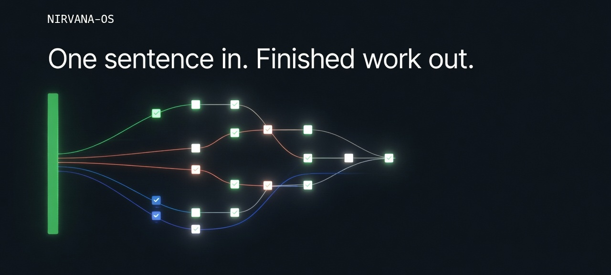
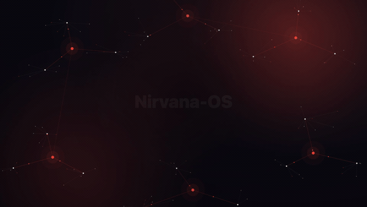

<div align="center">



# Nirvana-OS

**عمليات وكلاء جاهزة للتشغيل.** جملة واحدة تدخل. عمل منجز يخرج.

[](https://github.com/gutomec/nirvana-os-engine/stargazers)
[](./CHANGELOG.md)
[](https://github.com/gutomec/nirvana-os-engine/actions/workflows/smoke.yml)
[](./LICENSE)

**macOS / Linux**

```bash
curl -fsSL https://gutomec.github.io/nirvana-os-engine/install.sh | bash
```

**Windows (PowerShell)**

```powershell
irm https://gutomec.github.io/nirvana-os-engine/install.ps1 | iex
```

[التوثيق](https://gutomec.github.io/nirvana-os-engine/) · [Packs](https://squads.sh/pt/packs) · [التثبيت المصوّر](https://gutomec.github.io/nirvana-os-engine/install.html) · [Changelog](./CHANGELOG.md)

**اقرأ هذا بلغتك:** [English](./README.md) · [Português](./README.pt-BR.md) · [Español](./README.es.md) · [中文](./README.zh.md) · [हिन्दी](./README.hi.md) · [العربية](./README.ar.md)

</div>

---

## أنت تتحدث إلى وكيلك. ووكيلك يشغّل Nirvana.

أنت تعمل بالفعل مع وكيل في الطرفية: Claude Code أو Codex أو Antigravity أو Pi أو Grok أو غيرها. موجّه واحد يعطي جواباً جيداً واحداً. العمل الحقيقي يتطلب باحثاً وكاتباً ومراجعاً ومشغّلاً، مع سجل يبيّن من فعل ماذا.

يمنح Nirvana-OS وكيلك هذا التنظيم. تطلب بلغة بسيطة، فيستخدم الوكيل Nirvana لاختيار الشركات وsquads وmind-clones المناسبة، وتوزيعها، والتحقق مما يعود منها، وعرض الإيصال عليك. لا تتعلم واجهة جديدة ولا تكتب أوامر في عملك اليومي. الأوامر الواردة أدناه هي المرجع الذي يستخدمه وكيلك، وهي متاحة لك متى أردتها.

## ما هو

Nirvana-OS نظام متعدد الوكلاء، أصيل في Bun ومستقل عن بيئة التشغيل. يعمل فوق الوكيل الذي تستخدمه أصلاً ولا يحل محله أبداً. يتعامل مع ثلاثة أنواع من المحتوى، وكلها مجلدات على جهازك:

| الركيزة | ما هي | أين تعيش |
|---|---|---|
| **الشركات (businesses)** | مؤسسات لها هيكل تنظيمي. الشركة التي يجري توزيعها تعمل كوكيل واحد يؤدي أدوار مقاعدها، ويستخدم squads عبر بطاقاتها، ويستحضر mind-clones | `~/businesses/` |
| **Squads** | فرق وكلاء قابلة للنقل، فيها وكلاء ومهام وسير عمل يتبعها الوكيل الموزَّع منهجاً له | `~/squads/` |
| **Mind-clones** | حمض نووي للشخصية في خمس طبقات، ليفكّر الوكيل ويكتب بمنهج خبير بعينه | `~/businesses/_library/dna/` |

يأتي المحرك بلا محتوى. تنشئ الشركات وsquads والنسخ بطلب ذلك من وكيلك، أو تثبّت حزمة من [squads.sh](https://squads.sh/pt/packs).

## التثبيت

شغّل الأمر ذا السطر الواحد في أعلى هذه الصفحة. يحتاج إلى `curl` (أو `wget`) و`tar`، وهما موجودان أصلاً في macOS وLinux وWindows 10+. لا حاجة إلى Node. إذا لم يكن [Bun](https://bun.sh) موجوداً، يضعه المثبّت في مجلد المستخدم (`~/.bun`) دون sudo ويتابع عمله.

ما يغيّره على جهازك:

- المحرك في `~/.nirvana/skills`؛
- الـ skill المسماة `nirvana`، مربوطة بكل بيئة تشغيل وكلاء يعثر عليها: `~/.claude/skills` و`~/.codex/skills` و`~/.gemini/config/skills` (Antigravity) و`~/.pi/agent/skills` و`~/.agents/skills` (OpenClaw)؛
- `nrv` و`nrv-hermes` في `~/.local/bin`، مع سطر PATH واحد في ملف تعريف الصدفة لديك (PATH الخاص بالمستخدم على Windows)؛
- خطافات تدقيق في Claude Code وAntigravity وCodex؛
- مجلدات المحتوى الفارغة `~/squads` و`~/businesses` و`~/businesses/_library/dna`.

إعادة تشغيله آمنة. افتح طرفية جديدة بعد ذلك ليصبح `nrv` على PATH لديك، ثم اطلب من وكيلك: *"تحقق من أن Nirvana-OS مثبّت بشكل صحيح."* فيشغّل `nrv doctor`. رمز الخروج 1 يعني تحذيرات فقط؛ والرمز 2 يسرد ما فشل.

الأمر ذو السطر الواحد لا يطرح أسئلة. لاختيار ملف أداء عند التثبيت، مرّره إليه: `curl -fsSL https://gutomec.github.io/nirvana-os-engine/install.sh | bash -s -- --profile=balanced`. يمكنك أيضاً ضبطه لاحقاً بطلب ذلك من وكيلك (انظر [الإعدادات](#الإعدادات)).

الطرق الأخرى (الـ skill المسماة `nirvana` عبر skills.sh، والتثبيت من نسخة مستنسخة) موجودة في [INSTALL.md](./INSTALL.md).

## ابدأ مشروعاً

افتح المجلد الذي تريد العمل فيه، وشغّل وكيلك هناك، وقل: *"اضبط هذا المجلد كمشروع Nirvana-OS."* يشغّل الوكيل `nrv init .`، الذي يكتب `.nirvana/project.yaml` وملاحظة قصيرة في `AGENTS.md` و`CLAUDE.md` و`GEMINI.md`. تصل المخرجات إلى `outputs/` داخل المشروع.

هذه الملاحظة تُبقي وكيلك يعمل كالمعتاد. فهو لا يستخدم Nirvana إلا حين يستدعي طلبك ذلك:

- تذكره بالاسم ("استخدم Nirvana لـ…"، "عبر nirvana")؛
- تسمّي إحدى شركاتك أو squads أو mind-clones لديك أو تشير إليها ("شركة الإطلاق الخاصة بي"، "squad الكتابة الإعلانية"، "بصوت Hormozi")، بما في ذلك اسم حزمة؛
- تطلب أن يجري العمل، أو جزء منه، على بيئة تشغيل أخرى ("استخدم Codex لمراجعته").

إذا أردت أن ينسّق Nirvana كل المخرجات في مشروع ما، فقل *"نسّق كل شيء في هذا المشروع عبر Nirvana"*. يشغّل الوكيل `nrv init . --orchestrators=always`. افتح جلسة جديدة ليسري التغيير.

## ماذا تطلب من وكيلك

| تقول | يشغّل وكيلك |
|---|---|
| "ما الشركات / squads / mind-clones التي أملكها؟" | `nrv list-businesses`، `nrv list-squads`، `nrv list-clones` |
| "استخدم Nirvana لكتابة نص الإطلاق الإعلاني لـ X." | الـ harness: يختار الشركة، ويكتب موجزاً، `nrv dispatch … --exec` |
| "شغّل هذا عبر squad الكتابة الإعلانية، على Codex." | `nrv dispatch --squad <slug> … --exec --runtime codex` |
| "أوقف ذلك التشغيل." | `nrv run-track stop <run>` |
| "غيّر العنوان الرئيسي فيما سلّمته." | `nrv revise <project> "<change>"` |
| "أرني ما فعله ذلك التشغيل." | `nrv audit-view <project>` |
| "ثبّت تبعيات كل squads لديّ." | `nrv activate --all` |
| "حدّث Nirvana-OS." | `nrv update` |
| "حدّث حزمة Genesis Circle لديّ." | `nrv update genesis-circle` |
| "ضع Nirvana في الوضع الاقتصادي." | `nrv config set execution.profile economy --global` |

الطلبات الأكبر تعمل بالطريقة نفسها:

```text
استخدم Nirvana-OS لإنشاء شركة اسمها podcast-empire تنتج 3 بودكاستات في آن واحد
وتنشرها وتحقق منها الدخل. لكل برنامج تخصصه الخاص، ومقدّم بالذكاء الاصطناعي، وتقويم
تحريري، وقمع مستقل لتحقيق الدخل. نحو 7 موظفين.
```

```text
استخدم Nirvana-OS لتحويل النتاج العام لـ <author> إلى mind-clone كامل بالذكاء الاصطناعي.
```

```text
استخدم Nirvana-OS لإنتاج حزمة إطلاق: بحث سوق، ونص إعلاني لصفحة هبوط،
وتحليل تنافسي مفصّل.
```

ينسّق الوكيل ولا يكتب المُخرَج بنفسه أبداً. كل شركة يختارها تحصل على موجزها الخاص وتشغيلها الخاص، وتعمل بالتوازي حين تكون الأجزاء مستقلة.

<div align="center">
  
</div>

## الحزم

الحزم شركات وsquads وmind-clones منتقاة تُباع على [squads.sh](https://squads.sh/pt/packs). الحزمة الرائدة هي [Genesis Circle](https://squads.sh/pt/nirvana-os).

1. اشترِ الحزمة على squads.sh ونزّل ملف zip الخاص بها من لوحة التحكم.
2. فك ضغط الأرشيف كاملاً في مجلد، وافتح طرفية هناك وشغّل الإعداد:
   - macOS / Linux: `bash setup.sh`
   - Windows: `powershell -ExecutionPolicy Bypass -File setup.ps1`

   يثبّت الإعداد Bun عند الحاجة، ويثبّت المحرك أو يحدّثه، وينسخ المحتوى إلى `~/squads` و`~/businesses` و`~/businesses/_library/dna`، ويعيد بناء الفهارس، ويحفظ ترخيص الحزمة في `~/.nirvana-license/packs/<pack>/`.
3. تحدّث إلى وكيلك: *"استخدم Nirvana لسرد ما منحتني إياه حزمة Genesis Circle"*، ثم اطلب العمل بتسمية شركة أو squad أو الحزمة.

تُثبَّت تبعيات الـ squad عند الطلب في أول مرة يعمل فيها. لتجهيزها كلها مسبقاً، اطلب من وكيلك تثبيت تبعيات كل squad (`nrv activate --all`).

**تحديث حزمة.** اطلب من وكيلك تحديثها، أو شغّل `nrv update <pack>`. المكوّنات التي عدّلتها تُنسخ احتياطياً في `~/.nirvana/backups/packs/<pack>/` قبل أن يستبدلها التحديث. إذا فشل التحديث بخطأ في الترخيص، فنزّل الحزمة مجدداً من squads.sh وشغّل إعدادها مرة أخرى؛ فهذا يجدّد الترخيص أيضاً.

## تحديث المحرك

اطلب من وكيلك تحديث Nirvana-OS، أو شغّل `nrv update`. ينسخ `~/.nirvana/skills` احتياطياً أولاً ويحتفظ بإعداداتك ومحتواك. يذكر `nrv update --check` الإصدار الذي سيثبّته دون تغيير أي شيء.

لا ينقل التحديث المحرك أبداً إلى إصدار أقدم. المحرك المستقر لا ينتقل إلا إلى إصدار مستقر أحدث. أما بيتا فتنتقل إلى أحدث إصدار أعلى منها، بيتا كان أو مستقراً، لذا تصبح بيتا 0.15 هي 0.15.0 عند صدوره. بعد تحديث المحرك، يفحص `nrv update` أيضاً كل حزمة مثبّتة لها ترخيص ويخبرك حين يتوفر لإحداها إصدار أحدث.

## إصدارات بيتا

إصدارات بيتا هي prereleases على GitHub. الأمر ذو السطر الواحد يثبّت أحدث إصدار مستقر، لذا تُثبَّت بيتا بتحديد أرشيف tarball الخاص بها صراحةً:

```bash
curl -fsSL https://gutomec.github.io/nirvana-os-engine/install.sh | NIRVANA_ENGINE_URL=https://github.com/gutomec/nirvana-os-engine/releases/download/v<version>/nirvana-os-engine.tar.gz bash
```

```powershell
$env:NIRVANA_ENGINE_URL = "https://github.com/gutomec/nirvana-os-engine/releases/download/v<version>/nirvana-os-engine.tar.gz"
irm https://gutomec.github.io/nirvana-os-engine/install.ps1 | iex
Remove-Item Env:NIRVANA_ENGINE_URL
```

استبدل `<version>` بالإصدار، مثلاً `0.15.0-beta.6`. يبدأ الوسم بحرف `v`؛ ومن دونه يعيد التنزيل 404. قائمة الإصدارات موجودة على [GitHub](https://github.com/gutomec/nirvana-os-engine/releases). في PowerShell يبقى المتغير قائماً طوال عمر النافذة، ولهذا يحذفه السطر الأخير: ما دام مضبوطاً، يعيد `nrv update` تثبيت الأرشيف المحدد نفسه.

بمجرد الانتقال إلى بيتا، يُبقيك `nrv update` وكل إعداد حزمة على قناة بيتا. للعودة إلى الإصدار المستقر، شغّل الأمر العادي ذا السطر الواحد من أعلى هذه الصفحة: فهو يثبّت أحدث إصدار مستقر فوق بيتا، ويبقى محتواك وإعداداتك كما هي.

## الإعدادات

تتغيّر الإعدادات حين تطلب. يكفي أن تقول *"ضع Nirvana في الوضع الاقتصادي"* أو *"أقصى جودة"* أو *"ما المضبوط حالياً؟"*؛ فيشغّل وكيلك `nrv config` ويخبرك بما تغيّر.

يغيّر ملف الأداء عدة إعدادات دفعة واحدة:

| ملف الأداء | الجهد | سقف السياق لكل worker | المراجعة | الفحوص البصرية من الـ workers |
|---|---|---|---|---|
| `max` | xhigh | لا يوجد (افتراضي بيئة التشغيل) | كل تسليم، حتى جولتين | مفعّلة |
| `balanced` | high | 400k رمز | حين تطلبها قاعدة | معطّلة |
| `economy` | medium | 200k رمز | عند الطلب فقط | معطّلة |

لا يختار ملف الأداء النموذج أبداً؛ فالنموذج تحدده إعدادات بيئة التشغيل لديك. الإعداد الذي تغيّره صراحةً يتقدّم على ملف الأداء. يعرض `nrv config list` كل إعداد وقيمته ومصدره. المرجع الكامل في [docs/configuration.md](./docs/configuration.md).

## لماذا لعبارة "العمل منجز" معنى هنا

يمكن للمنسّق أن يعلن أي شيء في رسالته الأخيرة. يسند Nirvana-OS كل تسليم بأشياء يمكنك فتحها على القرص.

- **مسار التدقيق.** كل توزيع وحكم بوابة وتسليم هو حدث بالإلحاق فقط في `~/.harness-logs/<date>/audit.jsonl`. كل تشغيل بـ `--exec` يترك أيضاً سجلاً في `.nirvana/run-kernel.sqlite` الخاص بالمشروع. يعرض `nrv audit-view <project>` السلسلة كاملة.
- **متحقَّق منه على القرص.** يقارن `verify-deliverable` ما وعد به الموجز بالملفات الموجودة فعلاً، وتشغّل بوابة الجودة معايير تقييم لكل نوع ملف، مع جولات تصحيح عند الإخفاق. التشغيل الذي تصمد إخفاقاته الجسيمة بعد التصحيحات يُحجب ولا يُسلَّم.
- **موجزات بمعايير.** يحمل كل موجز طلب المستخدم بنصه الحرفي ومعايير "يُعدّ منجزاً حين" قابلة للملاحظة؛ والمعايير الموسومة `(blocking)` هي التي تقرر ما إذا كان التسليم يجتاز.
- **الإنفاق تحت سيطرتك.** لا يُضبط أي سقف للتكلفة ما لم تطلبه (*"حدّد سقف كل تشغيل بـ US$ 5"* يضبط `budget.default_max_cost_usd`).

## مرجع الأوامر

للوكلاء والمستخدمين المتقدمين. يسرد `nrv help` كل شيء؛ ويعطي `nrv <command> --help` خيارات كل أمر. المرجع الكامل: [docs/CLI.md](./docs/CLI.md).

| الأمر | ما يفعله |
|---|---|
| `nrv doctor` | فحص السلامة: بيئات التشغيل، والخطافات، وروابط skills، والتبعيات، والسجلات، والتراخيص |
| `nrv init <dir>` | يجعل مجلداً مشروع Nirvana (`--orchestrators=always`، `--scope=project\|merge\|global`) |
| `nrv list-businesses` / `list-squads` / `list-clones` | تصفّح السجلات الثلاثة |
| `nrv find "<need>"` / `nrv search "<topic>"` | مرشحون مرتّبون لطلب ما / بحث بالكلمات المفتاحية عبر المكتبات |
| `nrv brief template\|check\|decide` | الموجز ذو الأقسام الستة الذي يكتبه المنسّق لشركة واحدة |
| `nrv dispatch <business> --brief-file <file> --exec` | تشغيل شركة على موجز؛ `--squad <slug>[:<capability>]` أو `--agent-x` أو `--auto` تسمّي أهدافاً أخرى. يرفض العمل دون `--exec` |
| `nrv run-track status\|stop <run>` | قراءة حالة تشغيل، أو إيقافه بشكل نظيف |
| `nrv revise <project> "<change>"` | تغيير تسليم في جلسة بيئة التشغيل نفسها |
| `nrv audit-view <project>` | سلسلة التدقيق لتشغيل ما |
| `nrv activate <squad>\|--all` | تجهيز بيئة squad مسبقاً في `~/.nirvana/envs/<squad>` |
| `nrv config list\|get\|set\|unset\|explain` | الإعدادات، مع `--global` أو `--project` |
| `nrv update [--check]` / `nrv update <pack>` | تحديث المحرك / حزمة |
| `nrv validate <squad\|business\|clone> <slug> [--fix]` | بوابة قبول لكيان واحد |
| `nrv glance` | قمرة قيادة على الويب (`--read-only` للتصفح فقط) |
| `nrv uninstall --engine` | إزالة المحرك مع الإبقاء على محتواك |

## الأسئلة الشائعة

**هل أحتاج إلى معرفة البرمجة؟** لا. تصف النتائج بلغة بسيطة؛ ووكيلك يشغّل Nirvana، والشركات وsquads تكتب وتتحقق وتسلّم.

**هل يحل محل وكيلي؟** لا. يعمل فوقه. العمل الموزَّع يجري على بيئة تشغيل جلستك ما لم تسمِّ غيرها: Claude Code أو Codex أو Antigravity أو Pi أو Kimi أو Grok أو Qwen Code أو OpenCode.

**أين يعيش عملي؟** على جهازك: المحتوى في `~/businesses` و`~/squads` و`~/businesses/_library/dna`، والمخرجات في `outputs/` الخاص بكل مشروع. لا توجد سحابة Nirvana في الحلقة.

**ماذا لو لم يناسب أي شيء في مكتبتي؟** يعمل الطلب رغم ذلك، على `agent-x`، الوكيل العام. ويمكنك أيضاً أن تطلب من وكيلك إنشاء الشركة أو الـ squad الناقصة.

**Windows؟** أصلي، عبر Bun. بلا WSL.

## الترخيص والتأليف والحالة

المؤلف: **Luiz Gustavo Vieira Rodrigues (gutomec / Prospecteezy)**. لا مؤلفين مشاركين.

الترخيص: Nirvana-OS Sustainable Use License (SUL) v1.0. المصدر منشور ومقروء علناً، والمحرك مجاني الاستخدام. إنه متاح المصدر، لا ترخيص مفتوح المصدر معتمداً من OSI، وبعض الاستخدامات التجارية تتطلب ترخيصاً تجارياً منفصلاً. اقرأ [LICENSE](./LICENSE) قبل الاعتماد على أي ملخص، بما في ذلك هذا.

الحالة: بيتا (0.x، حالياً 0.15.0-beta.6). المحرك يعمل اليوم ويُثبَّت في دقائق. توقّع أن تستمر الواجهة في التغيّر حتى الإصدار 1.0.
